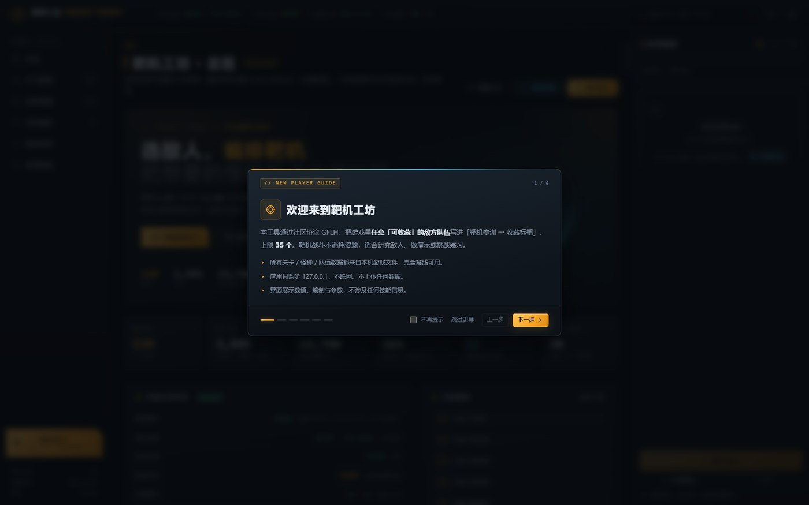

# GFLH Advance · 靶机工坊 (TargetForge)

把《少女前线》里**任意「可收藏」的敌方队伍**，可视化地编排进游戏内「靶机专训 → 收藏标靶」（最多 35 条）。
本项目是靶机工坊的应用本体：本地 Web 服务 + 数据层 + GFLH 登录抓取 / 注入模块 + 完整前端。

> **本仓库只包含应用代码与文档，不含任何游戏数据、账号凭证、日志或缓存。**
> 运行需要配合 [GF Forge](#前置依赖) 主仓库（提供本机 STC 数据解析与 GFLH 协议脚本）以及本机安装的游戏客户端。



| 关卡图鉴：8 组 110 章 2345 关 | 队伍详情：数值 / 参数 / 出处（不含技能） |
|---|---|
|  |  |

| 执行预览：删除 / 新增 / 保留 / 最终列表 | 使用教程：概念 / 流程 / FAQ / 安全 |
|---|---|
|  |  |

## 功能

- **关卡图鉴**：主线 / 活动 / 往期复刻 / 教学 / 特殊作战 / 模拟作战 / 灰域探查 / 无固定关卡，8 组 110 章 2345 关；
  章节卡 → 关卡列表 → 该关可收藏队伍，支持「整关全部加入序列」。
- **怪种图鉴**：264 个图鉴怪种，按阵营 / 固定关卡 / 灰域 / 无固定关卡筛选；怪种详情列出所有怪组并分页。
- **灰域（打灰）**：不逐节点列举关卡，折叠为 12 个区域，区域内直接分页浏览队伍（单个区域最多 1104 支）。
- **队伍详情**：效能、单位数、总血、关卡出处、参数；单位聚合表（等级 / 编制 / 数量 / 防御修正 / 坐标 /
  HP / 火力 / 命中 / 回避 / 护甲 / 穿甲 / 射程 / 移速 / 护盾 / 力场）。**不展示任何技能信息。**
- **序列编排**：加入 / 移除 / 拖拽排序 / 从当前靶机导入；上限 35，实时显示总单位 / 总血量。
- **执行注入**：先预览（删除 / 新增 / 保留 / 最终 1..N 列表 + 警告），支持
  `追加（append）` / `按序号替换（replace）` / `清空重排（rebuild）` 三种模式 + 清空全部 + 演练模式（dry-run，不联网）；
  执行过程有 job 日志，完成后引导大退重登，并提供「重启游戏」按钮（二次确认）。
- **登录抓取**：内置向导启动本地抓包代理（18080）→ 设置系统代理并重启游戏 → 抓取 uid / sign / 当前靶机 →
  关闭代理；也可加载历史凭证列表。
- **教程**：首次进入自动 6 步新手引导；教程页含概念、完整流程、抓取分步、三种执行模式、9 条 FAQ、安全须知。

数据规模（以当前国服客户端为例）：110 章 / 2345 关 / 13,700 支可收藏队伍 / 264 个可收藏怪种 / 灰域 12 区域 3352 队。

## 前置依赖

| 依赖 | 说明 |
|---|---|
| Windows 10/11 | 抓包 / 游戏控制 / winreg 代理设置目前是 Windows 实现 |
| Python 3.14 | 运行 `python -m targetforge`；需 `gflzirc>=0.4.4`（`python -m pip install gflzirc==0.4.4`） |
| GF Forge 主仓库 | 提供 `unit_model/`（STC 二进制表解析、等级缩放口径）、`scripts/gflh_target_train.py`（编号规划 / payload / 本地状态）、`dataMiner/derived/client_text.json` 与 `enemy_full_model.csv` 等派生数据 |
| 本机游戏客户端 | 《少女前线》PC 版（Steam appid **3347970**）；路径写入 GF Forge 的 `local_paths.json` 或环境变量 `GF1_GAME_ROOT` |
| 端口 | 应用 **8765**；抓包代理 **18080**（不要用 8080，常被其它 bot 占用） |
| 可选 | Playwright + Edge（页面自检 `tools/ui_selfcheck.py`），Pillow（截图工具） |

## 安装

```powershell
# 1) 克隆本仓库
git clone https://github.com/TenshiInHeaven/gflh_advance.git

# 2) 把 targetforge/ 整体复制到 GF Forge 仓库根目录，形成 <GF_FORGE_ROOT>\targetforge\...
xcopy /E /I gflh_advance\targetforge <GF_FORGE_ROOT>\targetforge

# 3) 安装依赖（已装可跳过）
python -m pip install gflzirc==0.4.4

# 4) 自检（可选）
cd <GF_FORGE_ROOT>
python -m unittest discover -s targetforge/tests -t .
```

> 也可以直接把本仓库克隆成 `<GF_FORGE_ROOT>\targetforge`：
> `git clone https://github.com/TenshiInHeaven/gflh_advance.git "<GF_FORGE_ROOT>\targetforge_tmp"`，
> 再把 `targetforge_tmp\targetforge` 移到 `<GF_FORGE_ROOT>\targetforge`。

## 运行

```powershell
cd <GF_FORGE_ROOT>
python -m targetforge                 # http://127.0.0.1:8765
python -m targetforge --open          # 顺便打开浏览器
python -m targetforge --port 8771     # 换端口
python -m targetforge --rebuild-catalog   # 强制重建数据缓存
```

首次启动会解析本机 STC 生成 `dataMiner/derived/targetforge/catalog.json`（约 4 秒，约 6.7 MB），之后直接读缓存（<1 秒）。
游戏更新后点顶栏「刷新数据」或加 `--rebuild-catalog`。

## 使用流程（简版）

1. **登录抓取**：页面左侧「登录抓取」→ 开始抓取 →「设置代理并重启游戏」→ 在游戏里登录进主界面 →
   等状态出现 uid / sign / 当前靶机 →「完成并关闭代理」。（sign 每次登录都变，过期需重抓）
2. **挑队伍**：关卡图鉴（选关卡 → 选队伍）或怪种图鉴（选怪种 → 选怪组）→「加入序列」。
3. **编排**：右侧序列面板 / 序列编排页拖拽排序（上限 35）。
4. **执行**：执行向导 → 选择模式 → 先「演练模式」看 payload 预览 → 正式执行 → 完成后**大退重登游戏**，
   游戏内「靶机专训 → 收藏标靶」查看。

### 三种执行模式

| 模式 | 语义 |
|---|---|
| 追加 `append` | 保留现有靶机，草稿按顺序接在已有最大 `order_id` 后面；已在列表里的队伍自动跳过 |
| 按序号替换 `replace` | 草稿第 i 个换成「收藏標靶 i」；草稿比现有长则追加到末尾，现有比草稿长则保留；若草稿队伍已存在于其它编号会先删旧项避免重复 |
| 清空重排 `rebuild` | 先删光现有靶机，再按草稿 1..N 全量 `addCollect`（编号最干净，推荐一次配好整套） |

另有独立的「清空全部」（危险操作，二次确认）。执行完必须大退重登同步；清空靶机后要强退，否则进靶机界面可能卡死。

## 数据与安全

- 所有关卡 / 怪种 / 怪组数据都来自**本机客户端 STC 静态表**，应用离线运行；本仓库不含这些数据。
- 应用只监听 `127.0.0.1`，不上传任何数据。
- 抓到的 `uid/sign` 只保存在本机 `dataMiner/derived/targetforge/creds_latest.json`（不入 git），**请勿提交或外传**。
- 抓包代理固定 `18080`；请确保使用完毕后系统代理已关闭。
- 本工具仅用于本地研究与学习；请遵守游戏服务条款，避免在主账号 / 线上环境滥用。产生的风险由使用者承担。

## 验证

```powershell
python -m unittest discover -s targetforge/tests -t .      # 105 个单测（app / catalog / gflh）
python targetforge/tools/api_smoke.py --url http://127.0.0.1:8765   # 真实数据 API 冒烟（28 项）
python targetforge/tools/ui_selfcheck.py --url http://127.0.0.1:8765 # Playwright 页面自检 + 15 张截图
```

前端自检结果：69 项 DOM 断言通过，console error / page error 均为 0。

## 目录

```text
gflh_advance/
  README.md                    本文件
  docs/screenshots/            README 用截图
  targetforge/                 复制到 GF Forge 仓库根目录后的模块
    app.py                     HTTP 服务 / 路由 / 序列状态 / 后台 job
    catalog.py                 STC → 章节 / 关卡 / 怪种 / 怪组数据层（缓存 + 查询）
    gflh.py                    登录抓取（GFLProxy）/ 序列规划 / 注入（addCollect·delCollect）/ 游戏控制
    static/                    前端（原生 HTML/CSS/JS，无构建步骤，离线）
    tests/                     unittest
    tools/                     api_smoke.py / ui_selfcheck.py / screenshot.py
    contract.md                模块 / API 契约
    README.md                  应用层说明
```

## 常见问题

- **8080 端口被占**：抓包固定用 18080；8080 常被其它 bot 占用，不要改过去。
- **error:300**：队伍不可收藏 / 队伍重复 / 删除时 `order_id` 不对。应用已尽量规避；仍报错先重新登录抓取当前靶机再试。
- **出现多个「收藏标靶1」**：编号撞了，用「清空重排」重建编号。
- **清空后进靶机界面卡死**：强退游戏重进。
- **注入后游戏里没变化**：大退重登游戏同步。
- **游戏进不去 / 网络异常**：检查系统代理是否已关闭（Windows 设置 → 网络和 Internet → 代理）。
- **sign 过期**：重新走一遍登录抓取。

## 相关项目

- [GFLH / ZIRC](https://github.com/MaaGF1) —— 社区 GFL 协议库（`gflzirc`），本项目的注入与抓包基于它。
- **GF Forge** —— 本项目的配套主仓库，提供本机 STC 数据层与 `gflh_target_train.py` 编号规划脚本（未包含在本仓库中）。

---

本项目与《少女前线》开发 / 运营方无关，不包含任何游戏素材。仓库未附带开源许可证，如需使用 / 转载请联系作者。
